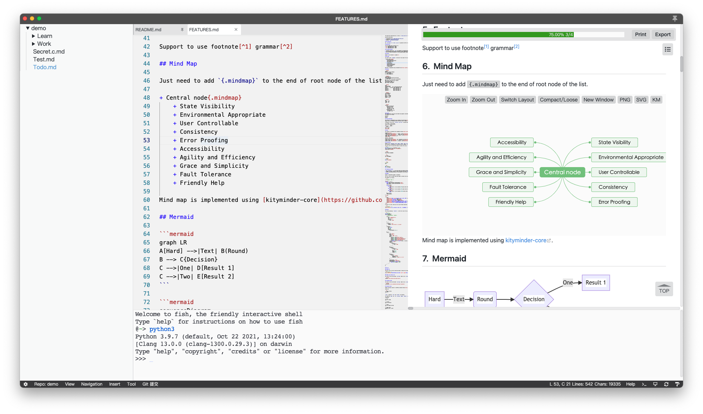
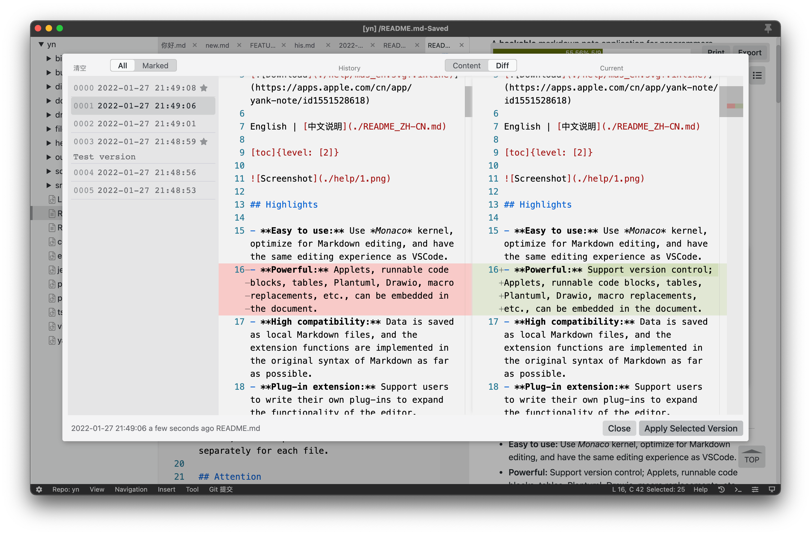
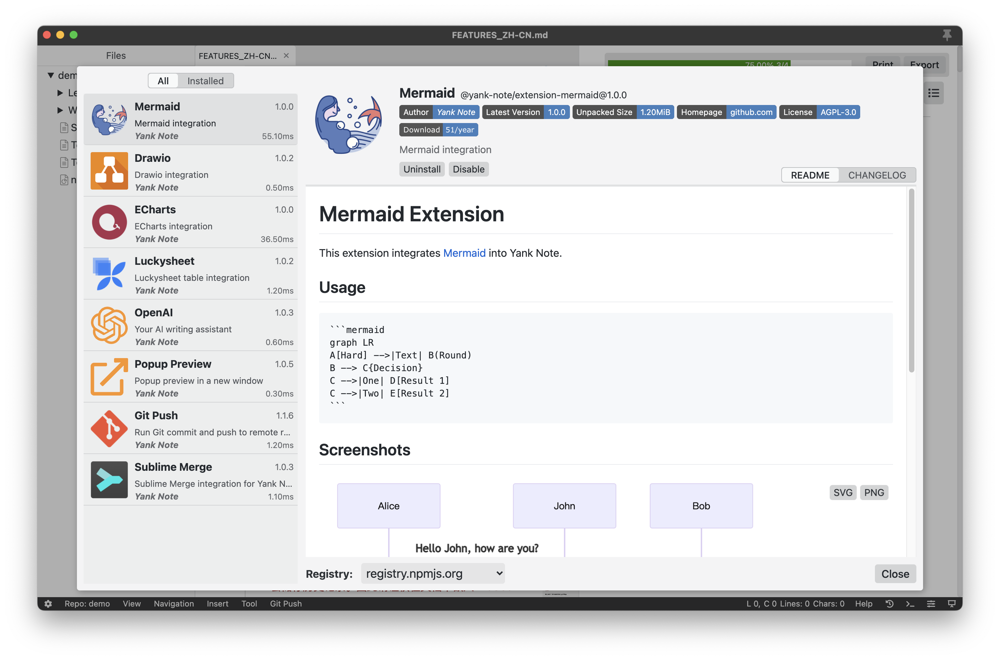
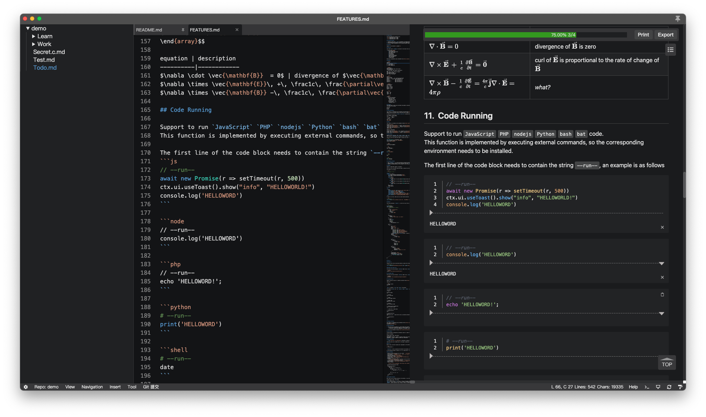
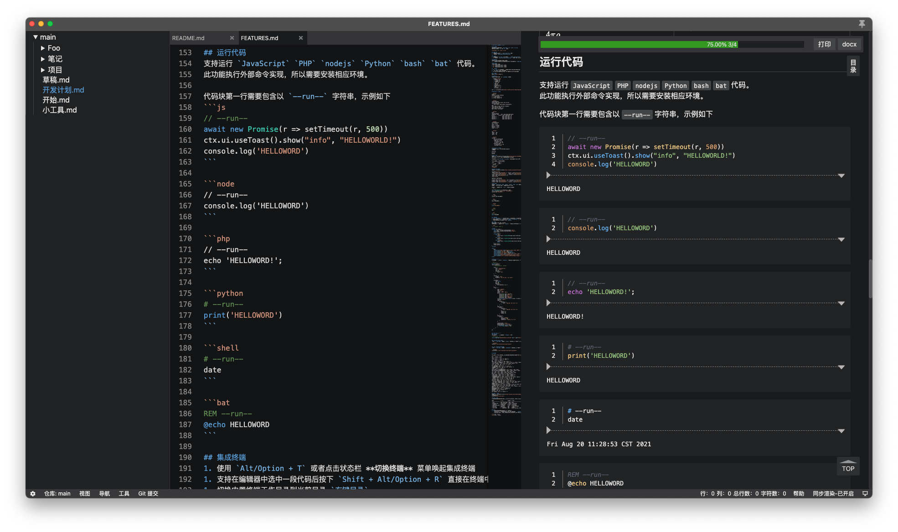
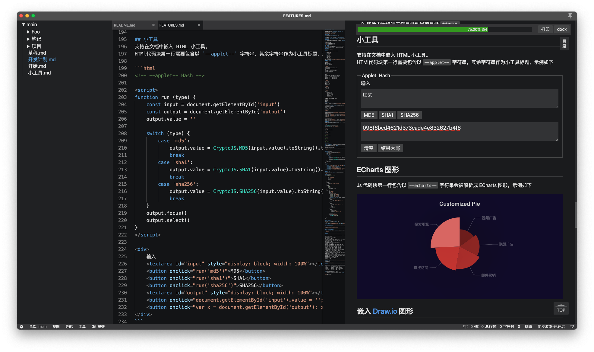
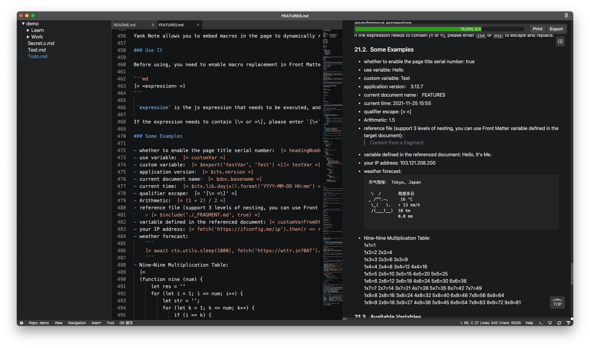

# Yank Note

Trình soạn thảo Markdown **có khả năng mở rộng cao**, được thiết kế để làm việc hiệu quả. **[Tải về](https://github.com/purocean/yn/releases)** | **[Dùng thử trực tuyến >>>](https://demo.yank-note.com/)**

 [Không khuyến nghị](https://github.com/purocean/yn/issues/65#issuecomment-1065799677)

[English](./README.md) | [中文说明](./README_ZH-CN.md) | [Русский](./README_RU.md) | Tiếng Việt

[toc]{level: [2]}

## Điểm nổi bật

- **Trợ lý AI:** **Hỗ trợ AI Copilot để hoàn thành văn bản, sinh nội dung và tạo ảnh (tương thích với OpenAI, Ollama, Gemini, Kimi, Tongyi Qianwen, Flux.1, v.v.); hỗ trợ OpenCode AI Agent để trợ giúp lập trình thông minh.**
- **Dễ sử dụng:** Dùng lõi *Monaco*, được tối ưu cho việc soạn thảo Markdown, mang lại trải nghiệm soạn thảo giống như VSCode.
- **Mạnh mẽ:** Hỗ trợ quản lý phiên bản; có thể nhúng Applet, khối code chạy được, bảng, PlantUML, Drawio, thay thế macro, v.v. vào tài liệu.
- **Tương thích cao:** Dữ liệu được lưu dưới dạng file Markdown cục bộ, các chức năng mở rộng được hiện thực bằng cú pháp gốc của Markdown nhiều nhất có thể.
- **Mở rộng bằng plugin:** Người dùng có thể tự viết plugin để mở rộng chức năng của trình soạn thảo.
- **Hỗ trợ mã hóa:** Dùng mã hóa để lưu các file riêng tư như thông tin tài khoản; mỗi file có thể đặt mật khẩu riêng.

## Lưu ý

- Để dễ mở rộng hơn, Yank Note hy sinh một phần bảo vệ an ninh (thực thi lệnh, đọc ghi file tùy ý). Nếu bạn muốn dùng nó để mở một file Markdown từ nguồn bên ngoài, ⚠️**hãy kiểm tra kỹ xem nội dung file có đáng tin cậy hay không**⚠️.
- Việc mã hóa và giải mã file được thực hiện hoàn toàn ở phía giao diện (front end). Hãy **nhớ kỹ mật khẩu của bạn**. Một khi mất mật khẩu, cách duy nhất là bẻ khóa bằng vét cạn.

## Các chức năng đặc trưng

Để biết thêm cách sử dụng các chức năng dưới đây, xem [mô tả các chức năng đặc trưng](./help/FEATURES_VI.md)

- **Cuộn đồng bộ:** vùng soạn thảo và vùng xem trước cuộn đồng bộ với nhau, vùng xem trước cũng có thể cuộn độc lập
- **Mục lục (Outline):** nhảy nhanh đến vị trí tương ứng trong tài liệu qua mục lục ở vùng xem trước
- **Quản lý phiên bản:** hỗ trợ xem lại các phiên bản lịch sử của tài liệu
- **Mã hóa:** các file có đuôi `.c.md` được coi là file mã hóa
- **Tự động lưu:** tự động lưu file sau khi chỉnh sửa, thanh tiêu đề chuyển màu cam để nhắc file chưa lưu (tài liệu mã hóa không được tự động lưu)
- **Soạn thảo:** tự động hoàn thành danh sách
- **Dán ảnh:** có thể dán nhanh ảnh từ clipboard và chèn dưới dạng file hoặc Base64
- **Nhúng tệp đính kèm:** có thể thêm tệp đính kèm vào tài liệu và nhấp để mở bằng hệ điều hành
- **Chạy code:** hỗ trợ chạy code JavaScript, PHP, nodejs, Python, bash
- **Danh sách việc cần làm:** hiển thị tiến độ việc cần làm trong tài liệu; nhấp để chuyển nhanh trạng thái
- **Mở nhanh:** dùng phím tắt để mở bảng chuyển file, giúp mở nhanh file, file được gắn thẻ và tìm kiếm toàn văn nội dung file
- **Terminal tích hợp:** mở terminal ngay trong trình soạn thảo và chuyển nhanh thư mục làm việc hiện tại
- **LaTeX:** hỗ trợ biểu thức LaTeX
- **Giao diện:** Markdown dùng kiểu dáng và tính năng của GitHub
- **Kho lưu trữ (Repository):** có thể định nghĩa nhiều vị trí lưu dữ liệu để phân loại tài liệu
- **Chuyển đổi liên kết ngoài:** chuyển ảnh từ liên kết ngoài hoặc ảnh Base64 thành ảnh cục bộ
- Phân tích HTML: có thể dùng trực tiếp code HTML trong tài liệu, hoặc dùng phím tắt để sao chép và dán HTML thành Markdown
- **Xuất nhiều định dạng:** phía backend dùng pandoc làm công cụ chuyển đổi
- **Mục lục (TOC):** viết `[toc]{type: "ol", level: [1,2,3]}` tại chỗ cần tạo mục lục
- **Sửa ô trong bảng:** nhấp đúp vào một ô của bảng để sửa nhanh
- **Sao chép liên kết tiêu đề:** sao chép đường dẫn liên kết của tiêu đề vào clipboard để dễ chèn vào file khác
- **Nhúng Applet:** tài liệu hỗ trợ nhúng Applet HTML
- **Nhúng đồ họa PlantUML:** tài liệu hỗ trợ nhúng đồ họa PlantUML
- **Nhúng đồ họa drawio:** tài liệu hỗ trợ nhúng đồ họa drawio
- **Nhúng đồ họa ECharts:** tài liệu hỗ trợ nhúng đồ họa ECharts
- **Nhúng đồ họa Mermaid:** tài liệu hỗ trợ nhúng đồ họa Mermaid
- **Nhúng bảng Luckysheet:** tài liệu hỗ trợ nhúng bảng tính Luckysheet
- **Sơ đồ tư duy:** danh sách lồng nhau có thể hiển thị dưới dạng sơ đồ tư duy
- **Thuộc tính phần tử:** có thể tùy chỉnh mọi thuộc tính của một phần tử
- **Bảng nâng cao:** hỗ trợ tiêu đề bảng, văn bản nhiều dòng, danh sách trong ô và các tính năng khác
- **Liên kết tài liệu:** hỗ trợ liên kết tới tài liệu khác và nhảy qua lại giữa các tài liệu
- **Chú thích cuối trang:** hỗ trợ viết chú thích cuối trang (footnote) trong tài liệu
- **Khối chứa tùy chỉnh:** hỗ trợ khối chứa (container) tùy chỉnh tương tự giao diện mặc định của VuePress
- **Thay thế macro:** hỗ trợ nhúng biểu thức JavaScript để thay thế động nội dung tài liệu
- **Dịch vụ lưu trữ ảnh:** hỗ trợ dịch vụ lưu trữ ảnh [PicGo](https://picgo.github.io/PicGo-Doc/)
- **Plugin tùy chỉnh:** hỗ trợ viết plugin JavaScript để mở rộng chức năng trình soạn thảo. Plugin được đặt trong `thư mục chính/plugins`. Xem [Hướng dẫn phát triển plugin](./help/PLUGIN_VI.md)

## Ảnh chụp màn hình

## Nhật ký thay đổi

### [v3.93.1](https://github.com/purocean/yn/releases/tag/v3.93.1) 2026-10-17

[Windows](https://github.com/purocean/yn/releases/download/v3.93.1/Yank-Note-win-x64-3.93.1.exe) | [macOS arm64](https://github.com/purocean/yn/releases/download/v3.93.1/Yank-Note-mac-arm64-3.93.1.dmg) | [macOS x64](https://github.com/purocean/yn/releases/download/v3.93.1/Yank-Note-mac-x64-3.93.1.dmg) | [Linux AppImage](https://github.com/purocean/yn/releases/download/v3.93.1/Yank-Note-linux-x86_64-3.93.1.AppImage) | [Linux deb](https://github.com/purocean/yn/releases/download/v3.93.1/Yank-Note-linux-amd64-3.93.1.deb)

1. fix: Tăng cường bảo mật
2. chore: Nâng cấp Electron lên 41.10.6 và cập nhật các phụ thuộc, bao gồm MCP SDK, KaTeX, Markdown-it và Undici

[Xem thêm ghi chú phát hành](https://github.com/purocean/yn/releases)

## Hỗ trợ

Nhóm WeChat

