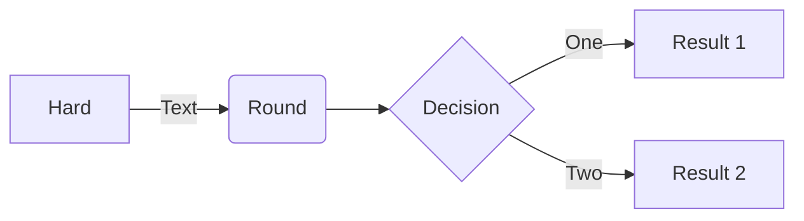
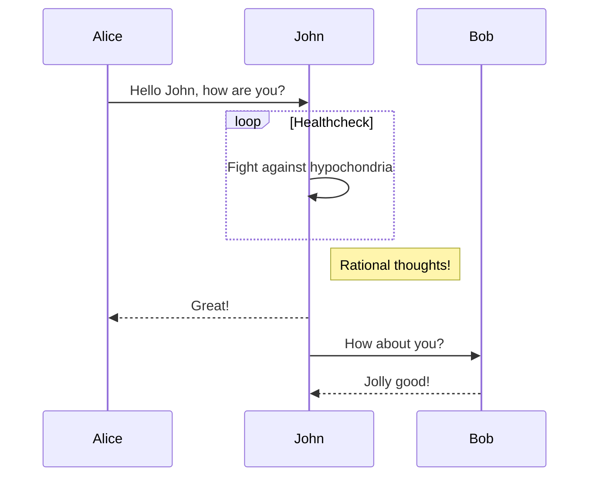
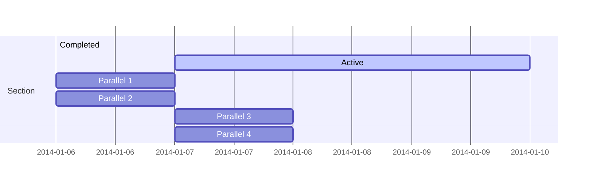
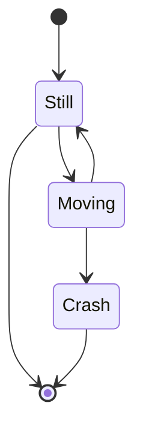
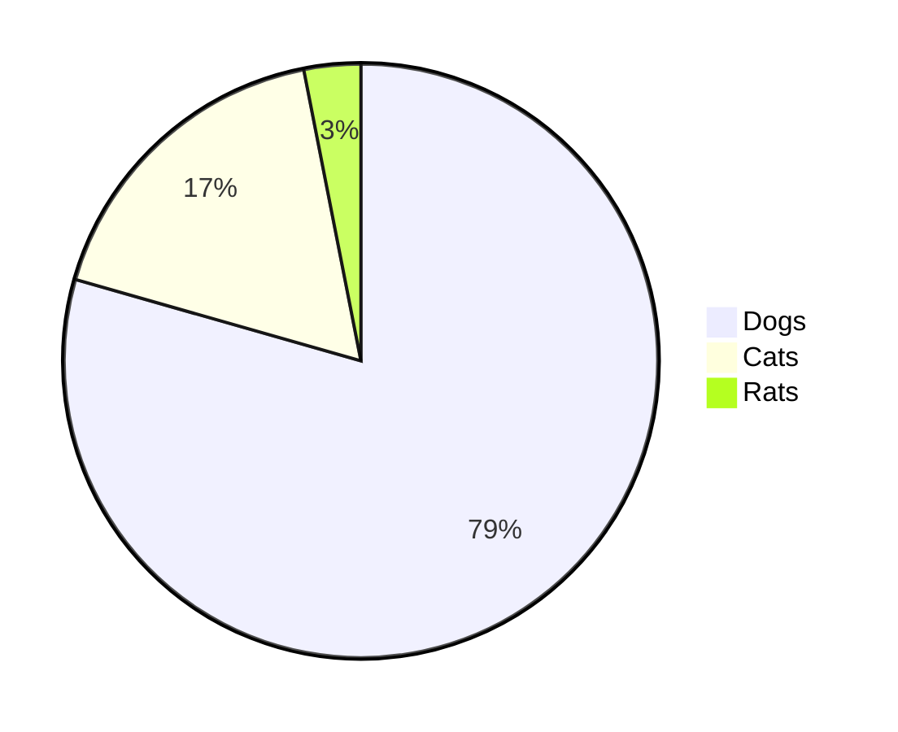
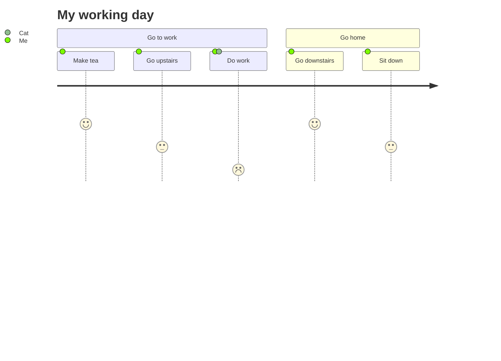

# Hướng dẫn các tính năng của Yank-Note

[English](./FEATURES.md) | [中文](./FEATURES_ZH-CN.md) | Tiếng Việt

[toc]{type: "ol", level: [2]}

## Lưu trữ dữ liệu

`<home>` là thư mục của người dùng hiện tại. Ví dụ:

1. Windows: `C:\Users\<username>`
1. Linux: `/home/<username>`
1. Mac: `/Users/<username>`

Dữ liệu do ứng dụng tạo ra được lưu trong thư mục `<home>/yank-note`, nhấp vào menu "Open Main Dir" (Mở thư mục chính) ở khay hệ thống để xem.

Mô tả các thư mục

1. file cấu hình `<home>/yank-note/config.json`
1. tài liệu tham chiếu khi xuất docx `<home>/yank-note/pandoc-reference.docx`
1. các phiên bản tài liệu `<home>/yank-note/histories`
    > [!TIP]
    > Nếu bạn vô tình làm mất nội dung tài liệu, hãy kiểm tra thư mục này và thử khôi phục.

    > [!CAUTION]
    > Vì lý do hiệu năng, tài liệu có hơn *102400* ký tự sẽ không được lưu lịch sử. Do đó, hãy cẩn thận khi nhúng ảnh Base64 vào tài liệu.

1. plugin `<home>/yank-note/plugins`
1. giao diện (theme) `<home>/yank-note/themes`
1. tiện ích mở rộng (extension) `<home>/yank-note/extensions`
1. dữ liệu người dùng khác `<home>/yank-note/data`

## Tạo mục lục

Dùng `[toc]{type: "ul", level: [1,2,3]}` để tạo mục lục cho tài liệu.

## Chuyển trạng thái TODO

Nhấp vào mục TODO trong vùng xem trước để thử
+ [x] ~~2021-06-06 10:27~~ TEST1
+ [x] ~~2021-06-06 10:27~~ TEST2
+ [x] ~~2021-06-06 10:27~~ TEST3

## Tài liệu mã hóa

1. Tài liệu có đuôi `.c.md` được coi là tài liệu mã hóa, có thể dùng để lưu thông tin bí mật.
2. Quá trình mã hóa và giải mã đều được thực hiện ở phía giao diện (frontend).
3. Hãy giữ cẩn thận mật khẩu của tài liệu mã hóa. Một khi mất mật khẩu, cách duy nhất là bẻ khóa bằng vét cạn.

## Markdown mở rộng

Gõ '/' trong trình soạn thảo để xem gợi ý

+ Đánh dấu: ==được đánh dấu==
+ Chỉ số trên: 29^th^
+ Chỉ số dưới: H~2~0
+ Chú thích: cú pháp[^1] chú thích[^2]
+ Emoji: :) :joy:
+ Viết tắt:
    *[HTML]: Hyper Text Markup Language
    *[W3C]:  World Wide Web Consortium
    Đặc tả HTML được duy trì bởi W3C.
+ Wiki Link: Hỗ trợ dùng cú pháp `[[tên-file#neo|văn bản hiển thị]]` hoặc `[[tên-file:dòng,cột|văn bản hiển thị]]` để liên kết tài liệu, ví dụ [[README#Highlights|Tính năng]] [[README:3,4]]
+ Thẻ: #Markdown #Help

## Github Alerts

Tính năng này được hiện thực bằng [markdown-it-github-alerts](https://github.com/antfu/markdown-it-github-alerts), hỗ trợ [hộp cảnh báo kiểu GitHub](https://github.com/orgs/community/discussions/16925).

> [!NOTE] Ghi chú
> Làm nổi bật thông tin người dùng nên lưu ý, kể cả khi chỉ đọc lướt.

> [!TIP]
> Thông tin tùy chọn giúp người dùng làm việc hiệu quả hơn.

> [!IMPORTANT]
> Thông tin quan trọng, cần thiết để người dùng thành công.

> [!WARNING]
> Nội dung trọng yếu cần người dùng chú ý ngay vì có rủi ro tiềm ẩn.

> [!CAUTION]
> Hậu quả tiêu cực có thể xảy ra của một hành động.

### Thuộc tính phần tử

Tính năng này được hiện thực bằng [markdown-it-attributes](https://github.com/purocean/markdown-it-attributes).

- Chữ đỏ, nền trắng, có viền, căn giữa {.bgw .text-center .with-border style="color:red"}
- Hiển thị dạng **phần tử khối**{.block}
- Thoát ký tự\{style="color:red"}

**Một số class kiểu dáng tích hợp sẵn:**

| Tên class | Mô tả |
| -- | -- |
| `avoid-page-break` | Tránh ngắt trang bên trong phần tử khi in/xuất PDF |
| `new-page` | Ngắt trang trước phần tử khi in/xuất PDF |
| `skip-print` | Bỏ qua phần tử khi in/xuất PDF |
| `skip-export` | Bỏ qua phần tử khi xuất/sao chép HTML |
| `inline` | Hiển thị phần tử hiện tại dưới dạng phần tử nội dòng |
| `block` | Hiển thị phần tử hiện tại dưới dạng phần tử khối |
| `reduce-brightness` | Giảm độ sáng của phần tử khi dùng giao diện tối |
| `bgw` | Đặt nền trắng cho phần tử hiện tại |
| `copy-inner-text` | Đánh dấu để "Ctrl/Cmd + nhấp chuột trái" sao chép văn bản của phần tử |
| `wrap-code` | Áp dụng cho khối code để tự động xuống dòng |
| `text-left` | Căn trái văn bản của phần tử hiện tại |
| `text-center` | Căn giữa văn bản của phần tử hiện tại |
| `text-right` | Căn phải văn bản của phần tử hiện tại |
| `with-border` | Thêm viền cho phần tử hiện tại |

### Ảnh nâng cao


1. Nếu đoạn văn chỉ có một ảnh, ảnh sẽ được hiển thị như phần tử khối và căn giữa theo mặc định. Nếu muốn hiển thị ảnh như phần tử nội dòng, bạn có thể thêm `.inline` sau tham số liên kết ảnh, như ví dụ ở trên.
1. Nếu muốn thêm nền trắng cho ảnh để hiển thị đẹp hơn (với một số ảnh nền trong suốt), bạn có thể thêm `.bgw` sau tham số liên kết ảnh, ví dụ: 
1. Bạn có thể dùng [markdown-it-imsize](https://github.com/tatsy/markdown-it-imsize) để đặt kích thước ảnh. Ví dụ, đây là ảnh có chiều rộng 16px: 

## Sơ đồ tư duy

Chỉ cần thêm `{.mindmap}` vào cuối nút gốc của danh sách.

+ Nút trung tâm{.mindmap}
    + [1] Hiển thị trạng thái
    + [2] Phù hợp với môi trường
    + [3] Người dùng kiểm soát được
    + [4] Nhất quán
    + [5] Phòng tránh lỗi
    + [6] Dễ tiếp cận
    + [7] Linh hoạt và hiệu quả
    + [8] Tinh tế và đơn giản
    + [9] Chịu lỗi
    + [10] Trợ giúp thân thiện

Sơ đồ tư duy được hiện thực bằng [kityminder-core](https://github.com/fex-team/kityminder-core).

## Mermaid













## PlantUML

Bạn có thể *<a href="javascript: ctx.setting.showSettingPanel('plantuml-api')">cấu hình</a>* trong phần Cài đặt để dùng endpoint cục bộ hoặc endpoint trực tuyến của PlantUML để tạo đồ họa.

> [!IMPORTANT]
> Nếu dùng endpoint cục bộ, hệ thống cần có môi trường Java và đã cài Graphviz.
Nếu xuất hiện lỗi `Cannot find Graphviz`,
hãy xem [Test your GraphViz installation](https://plantuml.com/graphviz-dot)

Ví dụ như sau

@startuml
a -> b
@enduml

## Bảng nâng cao

Tính năng này được hiện thực bằng [markdown-it-multimd-table](https://github.com/RedBug312/markdown-it-multimd-table).
Hỗ trợ dùng văn bản nhiều dòng và danh sách trong bảng. Hỗ trợ hiển thị chú thích của bảng.

Bạn có thể nhấp đúp hoặc nhấp chuột phải vào một ô để sửa nhanh nội dung. Dưới đây là các phím tắt liên quan:

- `DBLClick`: Sửa ô
- `Escape`: Thoát chế độ sửa
- `Enter`: Xác nhận và chuyển xuống hàng tiếp theo
- `Shift + Enter`: Xác nhận và chuyển lên hàng trước
- `Cmd/Ctrl + Shift + Enter`: Xác nhận và chèn một hàng mới bên dưới
- `Tab`: Xác nhận và chuyển sang cột tiếp theo
- `Shift + Tab`: Xác nhận và chuyển về cột trước

First header | Second header
-------------|---------------
List:        | More  \
- [ ] over   | data  \
- several    |
Test | Test
[Bảng thử nghiệm]

First header | Second header
:-----------:|:--------------:
AAAAAAAAAAAA | BBBBBBBBBBBBBB
AAAAAAAAAAAA | BBBBBBBBBBBBBB
AAAAAAAAAAAA | BBBBBBBBBBBBBB
AAAAAAAAAAAA | BBBBBBBBBBBBBB
AAAAAAAAAAAA | BBBBBBBBBBBBBB
Test | Test
[Bảng nhỏ]
{.small}

| h1 | h2 | h3 |
| -- | -- | -- |
| x1 | x2 | x3 {rowspan=2 style="color:red"} |
| x4 {colspan=2} |
[Gộp ô]

## LaTeX

Tính năng này được cung cấp bởi [KaTeX](https://github.com/KaTeX/KaTeX).

$$
\begin{array}{c}
\nabla \times \vec{\mathbf{B}} -\, \frac1c\, \frac{\partial\vec{\mathbf{E}}}{\partial t} &
= \frac{4\pi}{c}\vec{\mathbf{j}}    \nabla \cdot \vec{\mathbf{E}} & = 4 \pi \rho \\
\nabla \times \vec{\mathbf{E}}\, +\, \frac1c\, \frac{\partial\vec{\mathbf{B}}}{\partial t} & = \vec{\mathbf{0}} \\
\nabla \cdot \vec{\mathbf{B}} & = 0
\end{array}
$$

phương trình | mô tả
----------|------------
$\nabla \cdot \vec{\mathbf{B}}  = 0$ | divergence của $\vec{\mathbf{B}}$ bằng 0
$\nabla \times \vec{\mathbf{E}}\, +\, \frac1c\, \frac{\partial\vec{\mathbf{B}}}{\partial t}  = \vec{\mathbf{0}}$ |  curl của $\vec{\mathbf{E}}$ tỉ lệ với tốc độ biến thiên của $\vec{\mathbf{B}}$
$\nabla \times \vec{\mathbf{B}} -\, \frac1c\, \frac{\partial\vec{\mathbf{E}}}{\partial t} = \frac{4\pi}{c}\vec{\mathbf{j}}    \nabla \cdot \vec{\mathbf{E}} = 4 \pi \rho$ | _cái gì vậy?_

## Chạy code

Hỗ trợ chạy code `JavaScript` `PHP` `nodejs` `Python` `bash` `bat`.
Chức năng này được hiện thực bằng cách thực thi lệnh bên ngoài, vì vậy cần cài đặt môi trường tương ứng.

Dòng đầu tiên của khối code cần chứa chuỗi `--run--`, ví dụ như sau

Code JS mặc định chạy trong Web Worker. Nếu cần chạy trên luồng chính, bạn có thể thêm tham số `--no-worker--` vào sau khối code.

```js
// --run--
await new Promise(r => setTimeout(r, 500))
console.log('HELLOWORLD')
```

Code chạy trên luồng chính có thể truy cập API của trình soạn thảo qua đối tượng `ctx`, như ví dụ sau.

```js
// --run-- --no-worker--
await new Promise(r => setTimeout(r, 500))
ctx.ui.useToast().show("info", "HELLOWORLD!")
console.log('HELLOWORLD')
```

Nếu cần xuất ra HTML, có thể thêm tham số `--output-html--` vào sau khối code.

```js
// --run-- --output-html--
console.log(`output <i>HTML</i>`)
```

```node
// --run--
console.log('HELLOWORLD')
```

```php
// --run--
echo 'HELLOWORLD!';
```

```python
# --run--
print('HELLOWORLD')
```

```shell
# --run--
date
```

```bat
REM --run--
@echo HELLOWORLD
```

```c
// --run-- gcc $tmpFile.c -o $tmpFile.out && $tmpFile.out

#include <stdio.h>

int main () {
    printf("Hello, World!");
    return 0;
}
```

```java
// --run-- java $tmpFile.java

class HelloWorld {
    public static void main(String[] args) {
        System.out.println("Hello, World!");
    }
}
```

## Terminal tích hợp

1. Dùng `Alt/Option + T` hoặc nhấp menu **Switch terminal** (Bật/tắt terminal) trên thanh trạng thái để mở terminal tích hợp
1. Hỗ trợ chọn một đoạn code trong trình soạn thảo rồi nhấn `Shift + Alt/Option + R` để chạy lệnh trực tiếp trong terminal, không cần sao chép và dán.
1. Chuyển thư mục làm việc của terminal sang thư mục hiện tại: `nhấp chuột phải vào thư mục`

## Applet

Hỗ trợ nhúng các applet HTML vào tài liệu.

Dòng đầu tiên của khối code HTML cần chứa chuỗi `--applet--`, phần chuỗi còn lại được dùng làm tiêu đề của applet.

Ví dụ như sau:

```html
<!-- --applet-- Hash -->

<script>
function run (type) {
    const input = document.getElementById('input')
    const output = document.getElementById('output')
    output.value = ''

    switch (type) {
        case 'md5':
            output.value = ctx.lib.cryptojs.MD5(input.value).toString().toLowerCase()
            break
        case 'sha1':
            output.value = ctx.lib.cryptojs.SHA1(input.value).toString().toLowerCase()
            break
        case 'sha256':
            output.value = ctx.lib.cryptojs.SHA256(input.value).toString().toLowerCase()
            break
    }
    output.focus()
    output.select()
}
</script>

<div>
    Input
    <textarea id="input" style="display: block; width: 100%"></textarea>
    <button onclick="run('md5')">MD5</button>
    <button onclick="run('sha1')">SHA1</button>
    <button onclick="run('sha256')">SHA256</button>
    <textarea id="output" style="display: block; width: 100%"></textarea>
    <button onclick="document.getElementById('input').value = ''; document.getElementById('output').value = ''">Clear</button>
    <button onclick="var x = document.getElementById('output'); x.value = x.value.toUpperCase()">Uppercase</button>
</div>
```
Nếu không có tiêu đề thì sẽ không có viền trang trí bên ngoài

```html
<!-- --applet--  -->
<button onclick="ctx.ui.useToast().show(`info`, `HELLOWORLD!`)">HELLO</button>
```

Bạn cũng có thể *<a href="javascript: ctx.showExtensionManager('@yank-note/extension-repl')">cài đặt và kích hoạt extension Vue Repl</a>* để viết applet bằng Vue SFC.

## ECharts

Khối code Js có dòng đầu tiên chứa chuỗi `--echarts--` sẽ được hiển thị thành đồ họa ECharts, ví dụ như sau

```js
// --echarts--

const option = {
    // backgroundColor: '#2c343c',

    title: {
        text: 'Customized Pie',
        left: 'center',
        top: 20,
        textStyle: {
            color: '#888'
        }
    },

    tooltip : {
        trigger: 'item',
        formatter: "{a} <br/>{b} : {c} ({d}%)"
    },

    visualMap: {
        show: false,
        min: 80,
        max: 600,
        inRange: {
            colorLightness: [0, 1]
        }
    },
    series : [
        {
            name:'referer',
            type:'pie',
            radius : '55%',
            center: ['50%', '50%'],
            data:[
                {value:335, name:'Direct visit'},
                {value:310, name:'Email marketing'},
                {value:274, name:'Affiliate advertising'},
                {value:235, name:'Video advertisement'},
                {value:400, name:'Search engine'}
            ].sort(function (a, b) { return a.value - b.value; }),
            roseType: 'radius',
            label: {
                normal: {
                    textStyle: {
                        color: '#888'
                    }
                }
            },
            labelLine: {
                normal: {
                    lineStyle: {
                        color: '#888'
                    },
                    smooth: 0.2,
                    length: 10,
                    length2: 20
                }
            },
            itemStyle: {
                normal: {
                    color: '#c23531',
                    shadowBlur: 200,
                    shadowColor: 'rgba(0, 0, 0, 0.5)'
                }
            },

            animationType: 'scale',
            animationEasing: 'elasticOut',
            animationDelay: function (idx) {
                return Math.random() * 200;
            }
        }
    ]
}

chart.setOption(option, true)
```

## Draw.io

Giá trị của thuộc tính liên kết `link-type` cần là chuỗi `drawio`. Việc dùng định dạng liên kết này không ảnh hưởng đến việc phân tích của các trình phân tích Markdown khác.

[drawio](./test.drawio){link-type="drawio"}

## Khối chứa (Container)

Hỗ trợ các chức năng tương tự [Container Block của VuePress](https://v2.vuepress.vuejs.org/zh/reference/default-theme/markdown.html#%E8%87%AA%E5%AE%9A%E4%B9%89%E5%AE%B9%E5%99%A8), được hiện thực bằng [markdown-it-container](https://github.com/markdown-it/markdown-it-container).

**Cách dùng**

```md
::: <type> [title]
[content]
:::
```

`type` là bắt buộc, `title` và `content` là tùy chọn.

Các `type` được hỗ trợ: tip, warning, danger, details, code-group, group, group-item, row, col, section, div

**Ví dụ**

::: tip
Đây là một gợi ý
:::

::: warning
Đây là một cảnh báo
:::

::: danger
Đây là một cảnh báo nguy hiểm
:::

::: danger DỪNG LẠI
Khu vực nguy hiểm, cấm đi qua
:::

::: details
Đây là một nhãn chi tiết
:::

::: details nhấp để mở rộng thêm
Đây là một nhãn chi tiết
:::

:::: group Đây là nhóm nhãn
::: group-item Tab 1
test 1
:::

::: group-item *Tab 2
test 2
Tiêu đề bắt đầu bằng `*` nghĩa là tab này được kích hoạt mặc định
:::

::: group-item Tab 3
test 3
:::
::::

::: code-group
```js [test.js]
let a = 1
```

```ts [test.ts]
let a: number = 1
```
:::


::::: row Các cột
:::: col TODO
::: warning
Mục 1
:::
::: warning
Mục 2
:::
::: warning
Mục 3
:::
::::
:::: col DONE
::: tip
Mục 4
:::
::: tip
Mục 5
:::
::::
:::::

:::: row
::: col Cột 1
test 1
:::
::: col Cột 2
test 2
:::
::: col Cột 3
test 3
:::
::::

## AI Copilot

Yank Note tích hợp với các nền tảng trí tuệ nhân tạo như [OpenAI](https://openai.com) và [Google AI](https://ai.google.dev/), cho phép các tính năng như tự động hoàn thành thông minh và viết lại văn bản.

> [!NOTE]
> Bạn cần tự lấy API token tương ứng. *<a href="javascript: ctx.showExtensionManager('@yank-note/extension-openai')">Cần cài đặt và bật extension AI Copilot</a>*.

## Front Matter

Trang hỗ trợ thông tin cấu hình tương tự [Jekyll Front Matter](https://jekyllrb.com/docs/front-matter/)

Các biến tích hợp sẵn

tên biến | kiểu | mô tả
---- | ----- | ---
`headingNumber` | `boolean` | có bật đánh số tiêu đề trong trang hay không
`wrapCode` | `boolean` | có bật tự động xuống dòng cho code hay không
`enableMacro` | `boolean` | có bật thay thế macro hay không
`tags` | `string[]` | thẻ của tài liệu
`define` | `Record<string, string>` | Định nghĩa macro, thay thế chuỗi
`defaultPreviewer` | `string` | Trình xem trước mặc định của tài liệu, một số extension có thể cung cấp giao diện xem trước đặc biệt. Ví dụ *<a href="javascript: ctx.showExtensionManager('@yank-note/extension-reveal-js')">extension Reveal.js</a>*
`mdOptions` | `Record<string, boolean>` | Tùy chọn phân tích của Markdown-it
`mdOptions.html` | `boolean` | Cho phép thẻ HTML trong mã nguồn
`mdOptions.breaks` | `boolean` | Chuyển `\n` trong đoạn văn thành `<br>`
`mdOptions.linkify` | `boolean` | Tự động chuyển văn bản giống URL thành liên kết
`mdOptions.typographer` | `boolean` | Bật một số thay thế không phụ thuộc ngôn ngữ + làm đẹp dấu ngoặc kép
`katex` | `Record<string, any>` | [Tùy chọn Katex](https://katex.org/docs/options.html)

## Thay thế macro
> [!NOTE]
> *<a href="javascript: ctx.showPremium()">Có trong phiên bản premium</a>*

Yank Note cho phép nhúng macro vào trang để thay thế động nội dung tài liệu.

> [!IMPORTANT]
> Trước khi dùng, bạn cần bật thay thế macro trong Front Matter bằng cách khai báo `enableMacro: true`.

> [!WARNING]
> Dùng thay thế macro có thể khiến số dòng giữa mã nguồn và vùng xem trước không khớp chính xác. Yank Note đã xử lý hết mức có thể, nhưng một số trường hợp vẫn có thể gây lỗi cuộn đồng bộ.

### Định nghĩa

Trường `define` có thể định nghĩa một số ánh xạ thay thế văn bản. Hỗ trợ định nghĩa trong file khác, hỗ trợ biểu thức macro. Chi tiết xem phần Front Matter ở đầu tài liệu này.

> [!TIP]
> Bạn có thể định nghĩa macro toàn cục trong <a href="javascript: ctx.setting.showSettingPanel('macros')">cài đặt</a>. Nhưng vẫn cần khai báo `enableMacro: true` trong Front Matter.

- Tên ứng dụng: --APP_NAME--
- Phiên bản ứng dụng: --APP_VERSION--
- Từ file khác: --TEST_DEFINE--

### Biểu thức macro

Cú pháp:

```md
[= <expression> =]
```

 `expression` là biểu thức js cần thực thi, hỗ trợ biểu thức bất đồng bộ await/Promise.

Nếu biểu thức cần chứa [\= hoặc =\], hãy nhập `[\=` hoặc `=\]` để thoát ký tự và thay thế.

### Ví dụ

- có bật đánh số tiêu đề trong trang hay không:  [= headingNumber =]
- dùng biến:  [= customVar =]
- biến tùy chỉnh:  [= $export('testVar', 'Test') =][= testVar =]
- hàm tùy chỉnh:  [= $export('format', (a, b) => `${a}, ${b}!`) =][= format('HELLO', 'WORLD') =]
- xử lý thêm: XXXXXXXXXXXXXX [= $afterMacro(src => src.replace(/X{4,}/g, 'YYYYY')) =]
- phiên bản ứng dụng: [= $ctx.version =]
- tên tài liệu hiện tại: [= $doc.basename =]
- thời gian hiện tại:  [= $ctx.lib.dayjs().format('YYYY-MM-DD HH:mm') =]
- đánh số thứ tự: [= $seq`Hình-` =] | [= $seq`Hình-` =] | [= $seq`Hình-` =] | [= $seq`Bảng-` =] | [= $seq`Bảng-` =]
- thoát ký tự giới hạn:  [= '[\= =\]' =]
- Phép tính:  [= (1 + 2) / 2 =]
- tham chiếu file (hỗ trợ lồng tối đa 3 cấp, có thể dùng biến Front Matter được định nghĩa trong tài liệu đích):
    > [= $include('./_FRAGMENT.md', true) =]
- biến được định nghĩa trong tài liệu được tham chiếu: [= customVarFromOtherDoc =]
- địa chỉ IP của bạn: [= fetch('https://ifconfig.me/ip').then(r => r.text()) =]
- dự báo thời tiết:
    ```
    [= await ctx.utils.sleep(1000), fetch('https://wttr.in?0AT').then(r => r.text()) =]
    ```
- Bảng cửu chương:
  [=
  (function nine (num) {
      let res = ''
      for (let i = 1; i <= num; i++) {
          let str = '';
          for (let k = 1; k <= num; k++) {
              if (i >= k) {
                  str += k + 'x' + i + '=' + i*k + ' ';
              }
          }
          res = res + str + '\n'
      }
      return res
  })(9)
  =]

### Các biến có sẵn

Biểu thức macro có thể dùng các biến được định nghĩa trong Front Matter, hoặc các biến tích hợp sẵn sau

tên biến | kiểu | mô tả
---- | ----- | ---
`$ctx` | `object` | `ctx` của trình soạn thảo, xem [Hướng dẫn phát triển plugin](PLUGIN_VI.md) và [Tài liệu API](https://yn-api-doc.vercel.app/modules/renderer_context.html)
`$include` | `(path: string, trim = false) => Result` | Phương thức chèn đoạn nội dung từ tài liệu khác
`$export` | `(key: string, val: any) => Result` | Định nghĩa một biến có thể dùng trong tài liệu này
`$afterMacro` | `(fn: (src: string) => string) => Result` | Định nghĩa hàm callback chạy sau khi thay thế macro, có thể dùng để xử lý thêm văn bản đã thay thế.
`$noop` | `() => Result` | không làm gì, dùng để giữ chỗ văn bản
`$doc` | `object` | Thông tin tài liệu hiện tại
`$seq` | `(label: string) => Result` | Đánh số thứ tự
`$doc.basename` | `string` | Tên file của tài liệu hiện tại (không có đuôi)
`$doc.name` | `string` | Tên file của tài liệu hiện tại
`$doc.path` | `string` | Đường dẫn tài liệu hiện tại
`$doc.repo` | `string` | Kho lưu trữ của tài liệu hiện tại
`$doc.content` | `string` | Nội dung tài liệu hiện tại
`$doc.status` | `'loaded', 'save-failed', 'saved'` | Trạng thái tài liệu hiện tại

## Tham số dòng lệnh

Khi chuyển tài liệu cho người khác, bạn có thể dùng script hoặc tham số dòng lệnh tùy chỉnh để khởi động ứng dụng, giúp người nhận xem tài liệu thuận tiện hơn.

tên               | công dụng    | giá trị mặc định |  mô tả                    | ví dụ
----------------- | ------------ | ----- | ----------------------- | ----
--port            | Cổng lắng nghe của server | 3044 | cổng                      | --port=8080
--disable-tray    | Tắt biểu tượng thường trú ở khay hệ thống | false | true/false              | --disable-tray
--readonly        | Trình soạn thảo chỉ đọc    | false | true/false               | --readonly
--show-status-bar | Hiển thị thanh trạng thái    | true  | true/false               | --show-status-bar=false
--data-dir        | Thư mục dữ liệu      | không có     |      chuỗi đường dẫn thư mục       | --data-dir='./.data'
--init-repo       | Tên kho lưu trữ ban đầu    | không có   | chuỗi                    | --init-repo='test'
--init-file       | Đường dẫn file cần mở  | không có   | đường dẫn file, tương đối với đường dẫn kho lưu trữ     | --init-file='/1.md'

## Kiểu dáng tùy chỉnh

1. Nhấp chuột phải vào biểu tượng ở khay hệ thống và chọn "Open Main Dir" (Mở thư mục chính), vào thư mục `themes`.
2. Sao chép `github.css` thành một file CSS mới và chỉnh sửa nó.
3. Mở Cài đặt => Giao diện => CSS tùy chỉnh để chuyển sang file CSS đó.

## CLI và MCP

Yank Note hỗ trợ CLI (Giao diện dòng lệnh) và MCP (Model Context Protocol) để bạn có thể tương tác với ứng dụng bằng lập trình.

Chi tiết xem [CLI và MCP](https://help.yank-note.com/cli-mcp.html).

## Phát triển plugin

Xem [Hướng dẫn phát triển plugin](PLUGIN_VI.md)

[^1]: Đây là một chú thích
[^2]: Đây cũng là một chú thích
